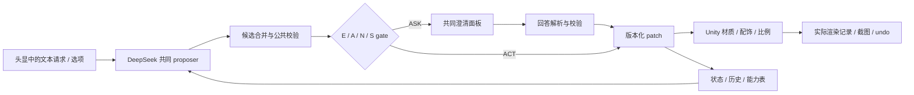

# 外形系统实现与设备路径

## 已验证的设备情况

2026-10-18 通过免密 SSH `desktop-ubuntu-ts` 连接成功；`desktop-ubuntu` 的局域网入口本次返回 connection refused。台式机为 Linux，20 个 CPU 线程、约 16 GiB 内存、RTX 5060 Ti 16 GiB 显存。Unity 2022.3.62f3c1 安装在 `/home/enjixiong/Unity/Hub/Editor/2022.3.62f3c1/Editor/Unity`，Android adb 和 Blender 可执行文件存在。

台式机项目 `/home/enjixiong/academics/AIAA4435/UnityStarter` 已有 RollingBall 课程作业，除 physics/ugui 外尚未发现 XR 包；不要以当前笔记本的旧 UnityStarter 覆盖该目录。之前的安装记录证明普通 Android APK 构建成功，不能据此声称 Pico VR 已运行。本次没有修改远端项目或启动付费模型调用。非交互 SSH 环境未设置 DEEPSEEK_API_KEY；没有读取或输出用户密钥，也未确定实际 API 服务已配置。

用户说明队友在 macOS 上测试过 Pico 连接，Ubuntu 未测试。PICO 官方说明区分了 macOS/Windows 桌面显示与仅 Windows 支持的 PCVR：<https://store-global.picoxr.com/en/detail/1/7257472870996230207>。因此不能直接复制“Mac 能显示桌面”作为 Ubuntu 沉浸式 VR 的证据。

第一天先复用队友真正跑通的项目和版本，确认以下之一：

1. **Unity Android APK 在 Pico 独立运行。** 台式机可用于场景制作与后端；构建沿用已验证的开发平台和 SDK。当前 Linux 上只有普通 Android 构建证据，PICO SDK 官方支持情况与具体构建仍需验证，不能预先保证无兼容问题。独立运行时最终渲染性能取决于头显，不取决于台式机 GPU。
2. **Windows PC + PICO Connect/SteamVR。** 复用一台已测试的 Windows 主机作为渲染端，台式机可继续提供后端服务。无需为了本课题改变已有 Ubuntu 安装。
3. 已有可运行的 Ubuntu VR 串流方案才复用。当前没有该证据，不把临时排查新串流栈放在正式采集当天。

验收必须在头显内检查双眼立体、头部 6DoF、控制器射线、world-space UI、30 分钟运行和日志回传；同时记录帧时、断连、构建与运行平台。不要用一次编辑器 Play 或普通桌面镜像替代。

## 共同 harness

建议 Python 后端提供 `/propose`、`/decide`、`/answer`、`/commit`、`/undo`、`/events`；Unity 只调用后端，API 密钥留在后端环境。服务仅向实验设备开放，不把密钥写进 APK 或版本库。DeepSeek 输出结构化数据，Unity 通过允许列表执行；不把生成的任意 C# 编译执行作为本周定制路径。

`state = {revision, jacket_color, accessory, scale}`。patch 只含被修改的字段，执行前要求 `expected_revision` 匹配。每次提交保存 before/patch/after；撤销某字段只恢复该字段，其他字段保持当前值。角色、灯光、界面与场景版本对全部条件一致。

三个核心参数：6 个固定外衣颜色、3 个配饰值、0.85–1.15 的比例网格（0.05 步长）。具体 RGB、prefab ID 和范围写在 policy.json，预实验确认可辨性。不是根据语义猜测“蓝色一定专业”或“戴眼镜一定聪明”；“正式/清爽/醒目”等词只能生成可能的具体解释，须由任务目标或用户反馈评估。

可以增加完整教室、已有角色动作、细致材质和背景物件；本周保持它们为共同环境，不再增加新的研究变量。预制角色优先，所有素材记录来源/许可；第 3 天冻结后不因美化更换模型或视觉效果。

## 可解释触发规则

先用同一个中立 proposer 生成最多 3 个合理候选及证据片段；允许只有一个，不能为了让 Selective 表现好而强行补出歧义。按最终 patch 合并同义候选。原生 gate 和规则 gate 获得同样的结构化分析，分析中不包含策略答案或隐藏目标。

| 规则 | ASK 条件 | 必须保留的反例 |
|---|---|---|
| R1 指代未解决 | 执行必需的对象/历史值存在至少两个有效解释，当前话语不能区分 | “恢复最早那顶帽子”已唯一定位；“恢复上一步”有唯一 undo 记录，都可以 ACT |
| R2 软偏好覆盖未明确 | 候选改变了已表达的持续偏好，并且请求未明确此次要覆盖它 | “虽然平时戴帽子，这次把帽子摘掉”明确覆盖，应 ACT；软偏好不能被所有条件的校验器当作硬锁 |
| R3 候选后果显著不同 | 至少两个有效候选改变不同字段，或改变互斥配饰/颜色，或比例差达到冻结阈值 | 两种措辞落到同一个 patch，合并后不询问；明确的高影响修改不因影响大自动触发 |
| 小步可逆例外 | 没有 R1/R2；只调整同一连续字段；默认幅度≤0.05、备选差≤0.05；有即时结果和 undo | 多字段歧义、未解决指代、偏好冲突不能被“小步”覆盖 |

判定次序：公共不可执行/技术故障出口 → R1 → R2 → 小步例外 → R3 → ACT。R1/R2/R3 还要求存在可回答、能区分当前候选的问题；若没有可用问题，报告 UNRESOLVED 并保持原状态。不要为了得到 ASK 数量无限追问。所有数值是设计起点，不是从文献获得的校准阈值。

问题只围绕当前缺失的一项信息，2–3 个对称选项，加“其他/都不是”和取消。明确请求的 Always-ask 使用一句确认。选项顺序由同一公共规则固定并记录，不能把正确答案总放首位。澄清得到的信息在回答后才进入该分支，不得提前给直接执行组看答案。

## DeepSeek 接口和冻结

官方当前 Chat Completions/JSON 模式提供文本与结构化输出；所查接口未列出 ASR/TTS：<https://api-docs.deepseek.com/api/create-chat-completion/>、<https://api-docs.deepseek.com/guides/json_mode/>。本周的文本外形实验不依赖模型原生语音能力。

请求起点是统一的模型别名、`thinking: {"type":"disabled"}`、`response_format: {"type":"json_object"}`，以及包含 JSON schema/示例的 system prompt。实际模型名在连接用户 API 后选定并冻结，不从未验证的网关硬编码。空内容、截断和无效字段按共同有界重试/失败规则处理；JSON 模式不替代 schema、参数范围与版本校验。有关 thinking 行为以实际服务为准：<https://api-docs.deepseek.com/guides/thinking_mode/>。

候选输出应包括 `candidates[{id,patch,evidence}]`、`default_id`、`unresolved_references`、`possible_soft_preference_overrides`，不要求未经校准的 0–1 “信心值”。R3 的字段差异在代码中计算；R1/R2 的语言分析可能错，日志中要区分 proposer 错与 gate 错。

每试次记录全部调用、等待、token（含可观测 reasoning）、错误和重试。初始阶段最多 4 次调用，单次输出上限/总预算在预实验后统一冻结；N 的决策调用是其真实额外成本。没有现场 DeepSeek 请求成功记录前，不写“已完成 API 接入”。
